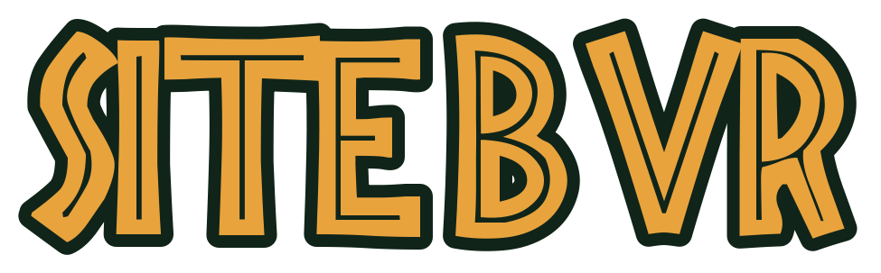
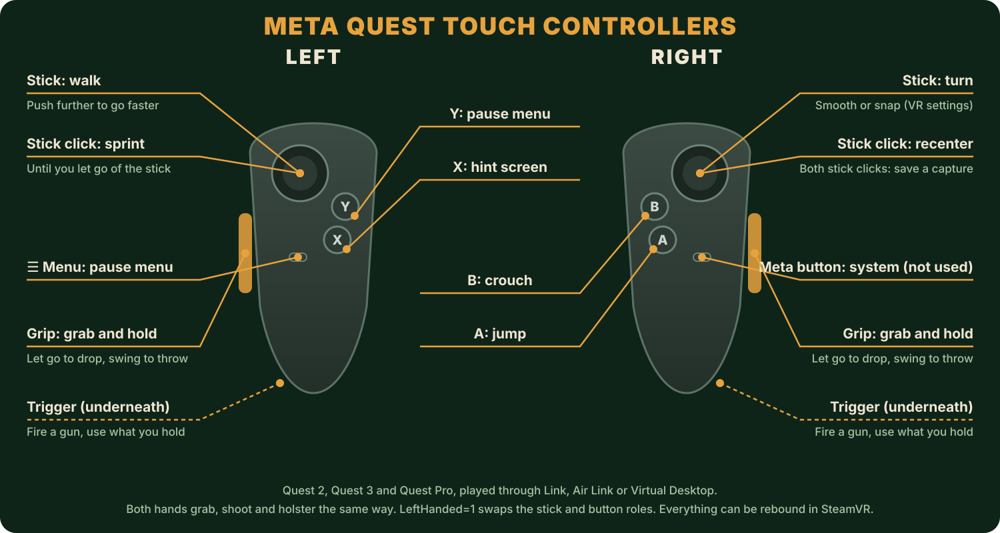
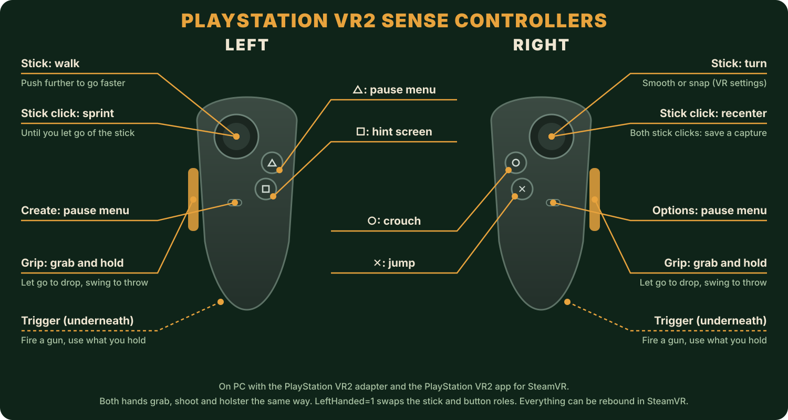
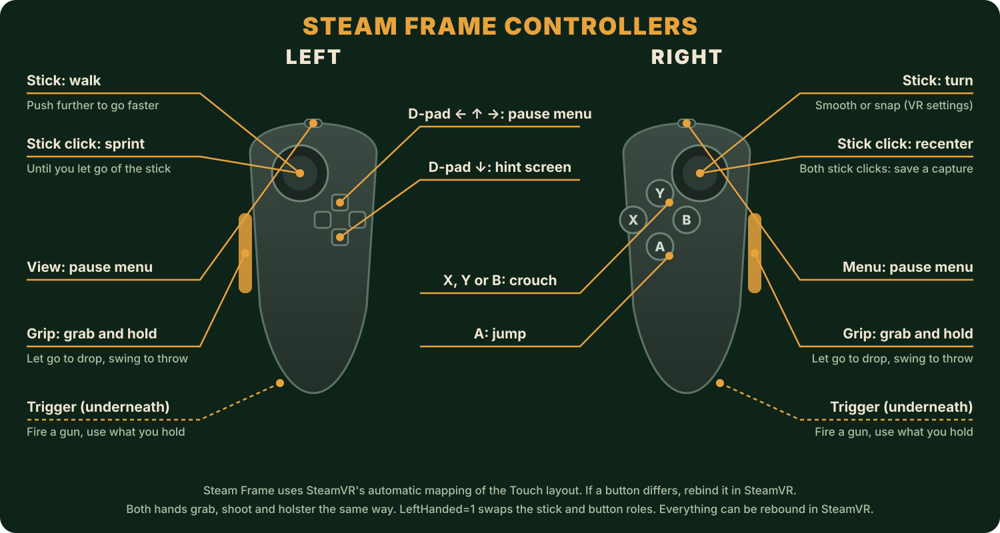
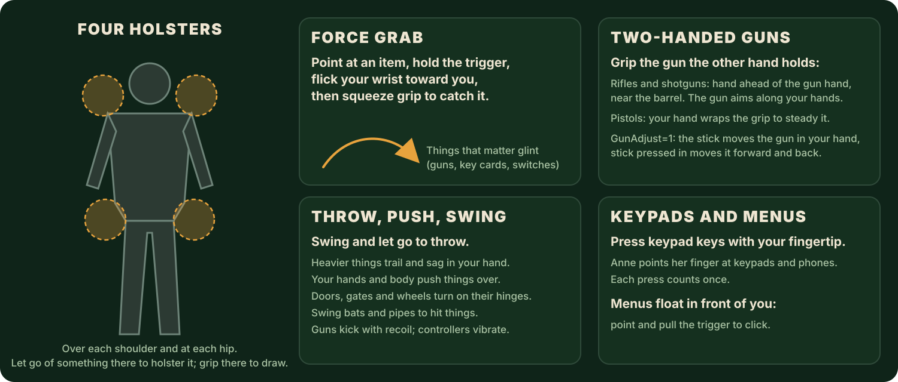

65 million prompts in the making . . . 

**Site B VR** is a fully featured virtual reality mod for *Jurassic Park: Trespasser* (1998). The game is now playable in its entirety in VR for the first time. Beyond just bringing the game to VR, I wanted to make sure this mod integrates VR into the game's existing systems in a way that respects Trespasser's original gameplay and, most importantly, is fun.

Walk the island in your own body, pick up anything with your own hands, aim guns with one or both hands,
and push, swing, and throw things with the game's original physics.

It is built on the [OpenTrespasser](https://github.com/OpenTrespasser/JurassicParkTrespasser) source code,
with a new Direct3D 11 renderer made for VR. It works with any SteamVR headset (Valve Index, Steam Frame, HTC Vive,
Meta Quest via Link, Air Link or Virtual Desktop, PlayStation VR2, Pico and others).

> Site B VR is a fan project. It is not affiliated with or endorsed by Universal, Amblin, DreamWorks
> Interactive or Electronic Arts. You need your own copy of the original game; no game data is included.

---

## Contents

- [Install](#install)
- [Controls](#controls)
- [Features](#features)
- [Settings](#settings)
- [Troubleshooting](#troubleshooting)
- [Building from source](#building-from-source)
- [Credits](#credits)

---

## Install

**You need:**
- Windows 10 or 11, 64-bit.
- SteamVR and a headset.
- Your own copy of *Jurassic Park: Trespasser*: the CD, a disc image of it, or an installed copy.

**Steps:**
1. Download `SiteB-VR.zip` from the [latest release](../../releases) and unzip it anywhere.
2. Run **`SiteBVR-Setup.exe`**.
3. Point it at your copy of the game:
   - the CD;
   - a disc image (`.iso`, `.cue`/`.bin`, `.img`, or a `.zip` holding one);
   - or a folder where Trespasser is already installed.
4. Press **Install**. Setup:
   - copies the game's files straight out of the disc or image, so you never run the 1998 installer;
   - checks that nothing is missing;
   - adds the mod and the VR Settings menu;
   - makes a **Site B VR** desktop shortcut.
5. Start SteamVR, then play from the shortcut.

To update the mod later, run the new `SiteBVR-Setup.exe` with step 3 left empty.

You can also install by hand: unzip everything into an existing Trespasser folder, next to `trespass.exe`.
For the VR Settings entry in the pause menu, add the contents of `menu\ingameopt_vr_addition.ddf` to the end
of a copy of `data\menu\ingameopt.ddf` saved as `menu\ingameopt.ddf`.

If no headset is found, the game runs normally on your monitor.

To watch or record, open SteamVR's **Display VR View** window.

---

## Controls

  
 
  
 
  

| Left controller | | Right controller | |
|---|---|---|---|
| Stick | Walk (push further to go faster) | Stick | Turn (smooth or snap) |
| Stick click | Sprint (until you let go of the stick) | Stick click | Recenter the view |
| X / □ (Frame: D-pad ↓) | The game's hint screen | A / ✕ | Jump |
| Y / △ (Frame: D-pad ← ↑ →) | Pause menu | B / ○ (Frame: X, Y or B) | Crouch (toggle) |
| Grip | Grab and hold | Grip | Grab and hold |
| Trigger | Fire / use | Trigger | Fire / use |

- The menu button on either controller also opens the pause menu.
- `LeftHanded=1` swaps the stick and button roles between the hands.
- You can rebind anything in **SteamVR > Settings > Controllers > Manage Controller Bindings**.
- The button pictures in tutorial messages match your controllers: PlayStation VR2 Sense, Touch, Index or Vive.
  The mod works out which ones you have.

  

---

## Features

### Your body, your hands
- **Six-degrees-of-freedom head and hands** in stereo, at your headset's native resolution and frame rate.
- **Anne's body is yours.** Look down and you see her, drawn at your own height so that her head is where yours
  is. Real crouching works.
- **Room-scale.** Walking around your room moves Anne with you. If a wall or rock blocks her, you can only lean
  a short way past it.
- **Both arms work.** Her arms follow your controllers with an elbow joint, and her forearm twists with your
  wrist. Her injured left arm is replaced by a working one.
- **The game's own hand shapes.** Each hand closes around what it holds the way it does in the original game,
  and Anne points her finger at keypads and phones.

### Moving around
- Analog walking with smooth acceleration, plus sprint, jump and crouch.
- Smooth or snap turning. The snap angle has a slider in the VR settings, from 15° to 90°.
- A new character controller: she slides along walls, steps up stairs and kerbs, and stands on crates and
  planks.
- **Slopes have limits.** From 40° she climbs slower and slower; past 55° she slips back down. You can't skip
  puzzles by walking up cliffs.
- **Swimming.** Deep water floats her with her head out, and you can dive off cliffs into it.
- Falling hurts, as in the original game.
- The view stays steady: height changes over stairs are smoothed, and nothing shakes or jumps under you.

### Picking things up
- **Grab anything** with either hand. Let go to drop it, or swing and let go to throw it.
- **Weight.** Heavier things trail behind your hand and sag a little. Things too heavy to lift can only be
  dragged.
- **Push and knock things over** with your hands and body.
- **Doors, gates, hatches and wheels** turn on their hinges when you pull them, and stay on.
- **Glints** show what you can use: guns, key cards and keypad switches sparkle (setting: *Weapon sparkle*).
- **Four holsters,** one at each hip and one over each shoulder. Let go of something there to holster it; grip
  there with an empty hand to draw it. Either hand can use any holster, and holstered items move with your body.
- **Keypads:** press keys with your fingertip. Each press counts once.
- Bats, pipes and other clubs hit things when you swing them.

### Guns
- **Point and shoot.** Every gun in the game is held and aimed with your hand.
- **Two-handed aiming:**
  - Rifles and shotguns: grip near the barrel, in front of your gun hand, and the gun aims along the line
    between your hands.
  - Pistols: your second hand wraps the grip to steady it.
  - Machine pistols such as the Uzi can be held like pistols.
- **Every gun sits correctly in your hand.** Each gun model has its own hand position for each hand, and its
  own supporting-hand position.
  - Versions of a gun with less ammo than usual use the normal version's placement.
  - With `GunAdjust=1` you can move a gun in your hand while wearing the headset:
    - the stick moves it left, right, up and down;
    - with the stick pressed in, it moves forward and back;
    - the stick on your supporting hand moves that hand.
- **Recoil and vibration** on every shot.
- **Sparks** fly off every metal surface you hit.
- **Mounted guns,** such as the .50 sniper on its tripod, come off their mount when you grab them.

### A new renderer
The world is drawn by a new Direct3D 11 renderer instead of the game's 1998 software renderer.
- **Both eyes in one pass,** at your headset's resolution, with anti-aliasing (MSAA with alpha-to-coverage).
- **Real-time sun shadows.**
- **Draw distance about 8× the original,** with haze measured by true distance, so it doesn't change as you
  turn your head.
- **Cloud sky.**
- **Terrain:**
  - the full-resolution ground textures;
  - roads, paths and beaches drawn by their own shapes;
  - fine ground built on the game's own terrain points, so things sit on it properly;
  - no cracks where the level of detail changes.
- **Water** you can see into, with sky reflections and moving waves.
- **The game's own particles:** blood, dust, splashes and sparks.
- **Blood on the ground** under wounded animals, blended into the ground as in the original game.
- **Animated textures,** such as surf washing up the beach.
- **Bump-mapped surfaces.**
- **See-through glass and effects,** such as muzzle flashes.
- **Characters with skeletons:** dinosaurs and Anne.
- **Fast:** small, distant objects are culled, and loading never shows the old renderer.

### Story, menus and sound
- **Floating menu screen:** point at it and pull the trigger to click.
- **VR Settings in the pause menu:**
  - smooth turning;
  - snap angle;
  - left-handed;
  - toggle grip;
  - vibration;
  - use my real height;
  - subtitles;
  - tutorial messages;
  - weapon sparkle.
- **Subtitles** for the game's voice-overs.
- **Tutorial and hint messages** reworded for VR, with pictures of your controller's buttons.
- **Hint button** on the left controller.
- Each chapter's title fades in when the level starts.
- The game's videos play in the headset.
- **Footsteps and plants:** footsteps, landings and the swish of plants as you brush through them, with a
  fallback sound on surfaces that had none.
- **The game's reverb** in caves and canyons, when your sound device supports it.

### Fixes to the original game
- An autosave at the start of each chapter, named "Autosave Chapter N".
- Fixed crashes:
  - when saving, from long save names and the free-space check;
  - in level 3, from shared physics shapes freed twice and from the terrain lookup memory overflowing;
  - in level 7;
  - after loading a save.
- Objects made of several physics boxes no longer lose their collision (the ramp deck, gate 1).
- The game can use 4 GB of memory.
- If the game crashes, it writes a report (`error.log`, plus a dump in `VRCapture/dumps`).

---

## Settings

Most options are in the **VR Settings** screen in the pause menu. Everything else is in `TrespasserVR.ini`,
which is created next to the exe the first time you run the game, with a comment on every option. Changes apply
within a couple of seconds, even mid-game, unless the comment says *restart*.

| Setting | What it does |
|---|---|
| `MoveSpeed` / `RunSpeed` | Walk and sprint speed in m/s (4.5 at most). |
| `MoveAcceleration` | How quickly you speed up and stop (seconds). |
| `MoveWithHand` | `1`: walk where your left hand points, not where you look. |
| `SmoothTurn` / `SmoothTurnSpeed` / `SnapTurnDegrees` | Turning. |
| `JumpHeight` | `1` = the original game's jump. |
| `LeftHanded` | Swap the stick and button roles. |
| `GripToggle` | `1`: press grip once to grab, again to drop. |
| `TwoHandAim`, `SecondHand` | Turn those features on or off. |
| `HolsterRadius`, `HipBack`, `HipDown`, `HipFrontScale` | Where the holsters are and how far they reach. |
| `Haptics` | Vibration strength (`0` = off). |
| `ThrowScale` | How much faster than your hand thrown things fly. |
| `HeldWeight` | How much held things trail and sag (`0` = none). |
| `Recoil` | How much guns kick. |
| `HandScale`, `ArmScale` | Size of Anne's hands and arms. |
| `HandPitch` / `HandYaw` / `HandRoll` | Rotate the in-game hand relative to your controller. |
| `GunAdjust` | `1`: move guns in your hand with the stick (saved per gun model). |
| `RealHeight` | `1`: your real floor is the game's floor; Anne is drawn at your height. |
| `AnneEyeHeight`, `HeadBelowEye`, `ExtraHeight` | Fine-tune where her body sits under your view. |
| `BodyLeash` | How far your head can go past Anne when she is blocked. |
| `Subtitles`, `Tutorial`, `ButtonPictures` | On-screen text and which button pictures it uses. |
| `NewRenderer` | `1` = the modern renderer (restart to apply). |
| `RenderScale` | Eye image size relative to SteamVR's recommendation. |
| `MSAA` | Anti-aliasing samples (1, 2, 4 or 8). |
| `ShadowMapSize`, `ShadowDistance` | Shadow quality and range (`0` = no shadows). |
| `DrawDistance` | How far away things are drawn (`1` = original). |
| `FogScale`, `RadialFog`, `SkyMode` | Haze and sky. |
| `Brightness`, `TerrainDetail` | Overall brightness, ground detail. |
| `BodyPassThrough` | A list of object IDs her body walks through (for invisible walls). |
| `ShowPhysics` | Debugging: draw the collision boxes near you. |

Per-gun hand positions are saved as `Gun_a<ammo>_d<damage>_t<time>...` lines at the end of the file.

---

## Troubleshooting

- **Something looks or behaves wrong?** Press **both stick clicks** together. The mod saves the last
  12 seconds to the `VRCapture` folder. Send that folder along with `TrespasserVR.log` from the game folder.
- **The game crashed?** Send `error.log` and the newest file in `VRCapture/dumps`.
- **`OpenTrespasser-Release.exe`** is a slower build with extra checks. Use it if the normal exe keeps crashing.
- **Settings broken?** Delete `TrespasserVR.ini` and it is recreated with the defaults.
- **No sound reverb in caves?** The game's reverb needs EAX, which many modern sound devices don't support.
  `TrespasserVR.log` says whether yours does.

---

## Building from source

The mod builds with Visual Studio 2022 and CMake as a 32-bit (x86) Windows program. Every push to the `vr-mod`
branch is built by GitHub Actions (`.github/workflows/build-vr.yml`) and published as the `latest` release.

After cloning, run `sh gitsyncscript.sh` (Git Bash on Windows) to fetch the submodules and Git LFS data. The VR
code is mostly in:
- `jp2_pc/Source/Trespass/VR*.cpp`: the SteamVR backend, the renderer, the scene and the mod's glue.
- `jp2_pc/Source/Game/DesignDaemon/Player.cpp`: the body, hands and guns.

---

## Credits

- **Site B VR** by [imspongy](https://github.com/imspongy).
- Built on **[OpenTrespasser](https://github.com/OpenTrespasser/JurassicParkTrespasser)**, the community's
  restoration of the *Trespasser* source code.
- *Jurassic Park: Trespasser* was made by DreamWorks Interactive (1998).
- Join the Trespasser community on [Discord](https://discord.gg/5EngSvu).
