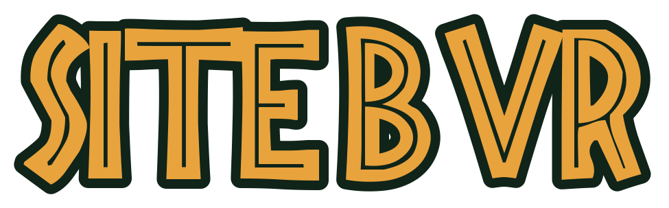
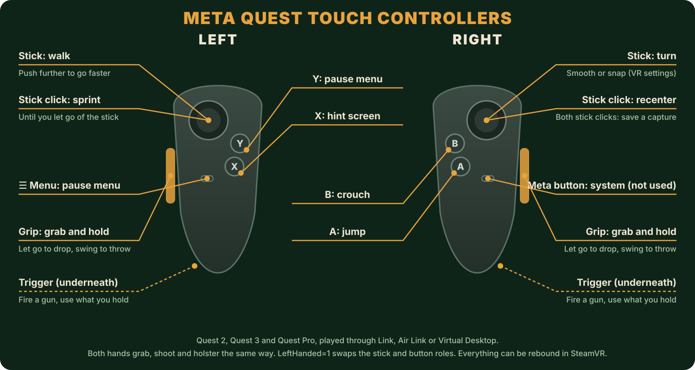
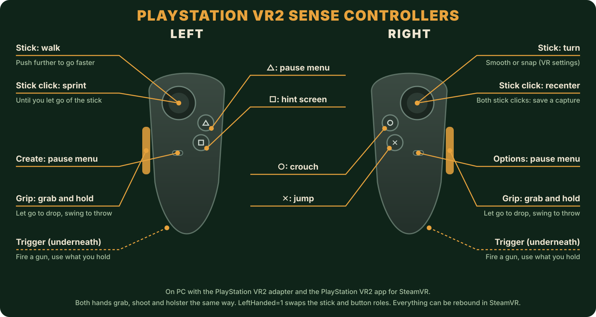
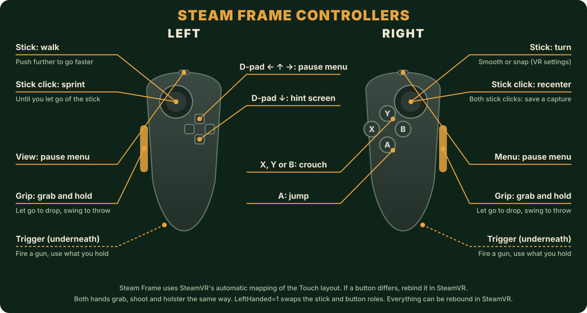
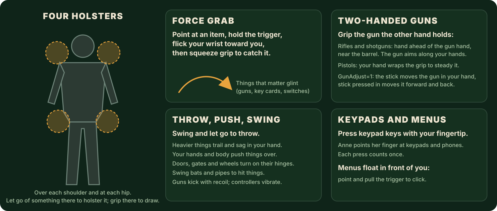

**Site B VR 1.0** — the whole of *Jurassic Park: Trespasser* (1998) in virtual reality. Walk the island in your own body, pick up anything with your own hands, aim with one or both hands, and swing, throw and push things through the game's original physics. Works with any SteamVR headset.

> A fan project, not affiliated with or endorsed by Universal, Amblin, DreamWorks Interactive or Electronic Arts. You need your own copy of the original game; no game data is included.

## Install
1. You need Windows 10/11 (64-bit), SteamVR, a Direct3D 11 graphics card, and your own copy of *Trespasser*: the CD, a disc image of it (`.iso`, `.cue`/`.bin`, `.img`) or an installed copy.
2. Download **SiteB-VR.zip** below, unzip it anywhere and run **SiteBVR-Setup.exe**.
3. Point it at your game and press **Install**. It copies the game's files straight out of the disc or image (no 1998 installer), checks nothing is missing, adds the mod and makes a **Site B VR** desktop shortcut.
4. Start SteamVR, then play from the shortcut.

## Controls

## Everything in this release

#### Your body, your hands
- **Six-degrees-of-freedom head and hands** in stereo, at your headset's native resolution and frame rate.
- **Anne's body is yours.** Look down and you see her, drawn at your own height so that her head is where yours
  is. Real crouching works.
- **Room-scale.** Walking around your room moves Anne with you. If a wall or rock blocks her, you can only lean
  a short way past it.
- **Both arms work.** Her arms follow your controllers with an elbow joint, and her forearm twists with your
  wrist. Her injured left arm is replaced by a working one.
- **The game's own hand shapes.** Each hand closes around what it holds the way it does in the original game,
  and Anne points her finger at keypads and phones.

#### Moving around
- Analog walking with smooth acceleration, plus sprint, jump and crouch.
- Smooth or snap turning. The snap angle has a slider in the VR settings, from 15° to 90°.
- A new character controller: she slides along walls, steps up stairs and kerbs, and stands on crates and
  planks.
- **Slopes have limits.** From 40° she climbs slower and slower; past 55° she slips back down. You can't skip
  puzzles by walking up cliffs.
- **Swimming.** Deep water floats her with her head out, and you can dive off cliffs into it.
- Falling hurts, as in the original game.
- The view stays steady: height changes over stairs are smoothed, and nothing shakes or jumps under you.

#### Picking things up
- **Grab anything** with either hand. Let go to drop it, or swing and let go to throw it.
- **Weight.** Heavier things trail behind your hand and sag a little. Things too heavy to lift can only be
  dragged.
- **Push and knock things over** with your hands and body.
- **Doors, gates, hatches and wheels** turn on their hinges when you pull them, and stay on.
- **Force grab:** point at an item, hold the trigger, flick your wrist toward you, then grip to catch it.
- **Glints** show what you can use: guns, key cards and keypad switches sparkle (setting: *Weapon sparkle*).
- **Four holsters,** one at each hip and one over each shoulder. Let go of something there to holster it; grip
  there with an empty hand to draw it. Either hand can use any holster, and holstered items move with your body.
- **Keypads:** press keys with your fingertip. Each press counts once.
- Bats, pipes and other clubs hit things when you swing them.

#### Guns
- **Point and shoot.** Every gun in the game is held and aimed with your hand.
- **Two-handed aiming:**
  - Rifles and shotguns: grip near the barrel, in front of your gun hand, and the gun aims along the line
    between your hands.
  - Pistols: your second hand wraps the grip to steady it.
  - Machine pistols such as the Uzi can be held like pistols.
- **Every gun sits correctly in your hand.** Each gun model has its own hand position for each hand, and its
  own supporting-hand position.
  - Versions of a gun with less ammo than usual use the normal version's placement.
  - With `GunAdjust=1` you can move a gun in your hand while wearing the headset:
    - the stick moves it left, right, up and down;
    - with the stick pressed in, it moves forward and back;
    - the stick on your supporting hand moves that hand.
- **Recoil and vibration** on every shot.
- **Sparks** fly off every metal surface you hit.
- **Mounted guns,** such as the .50 sniper on its tripod, come off their mount when you grab them.

#### A new renderer
The world is drawn by a new Direct3D 11 renderer instead of the game's 1998 software renderer.
- **Both eyes in one pass,** at your headset's resolution, with anti-aliasing (MSAA with alpha-to-coverage).
- **Real-time sun shadows.**
- **Draw distance about 8× the original,** with haze measured by true distance, so it doesn't change as you
  turn your head.
- **Cloud sky.**
- **Terrain:**
  - the full-resolution ground textures;
  - roads, paths and beaches drawn by their own shapes;
  - fine ground built on the game's own terrain points, so things sit on it properly;
  - no cracks where the level of detail changes.
- **Water** you can see into, with sky reflections and moving waves.
- **The game's own particles:** blood, dust, splashes and sparks.
- **Blood on the ground** under wounded animals, blended into the ground as in the original game.
- **Animated textures,** such as surf washing up the beach.
- **Bump-mapped surfaces.**
- **See-through glass and effects,** such as muzzle flashes.
- **Characters with skeletons:** dinosaurs and Anne.
- **Fast:** small, distant objects are culled, and loading never shows the old renderer.

#### Story, menus and sound
- **Floating menu screen:** point at it and pull the trigger to click.
- **VR Settings in the pause menu:**
  - smooth turning;
  - snap angle;
  - left-handed;
  - toggle grip;
  - vibration;
  - use my real height;
  - subtitles;
  - tutorial messages;
  - weapon sparkle.
- **Subtitles** for the game's voice-overs.
- **Tutorial and hint messages** reworded for VR, with pictures of your controller's buttons.
- **Hint button** on the left controller.
- Each chapter's title fades in when the level starts.
- The game's videos play in the headset.
- **Footsteps and plants:** footsteps, landings and the swish of plants as you brush through them, with a
  fallback sound on surfaces that had none.
- **The game's reverb** in caves and canyons, when your sound device supports it.

#### Fixes to the original game
- An autosave at the start of each chapter, named "Autosave Chapter N".
- Fixed crashes:
  - when saving, from long save names and the free-space check;
  - in level 3, from shared physics shapes freed twice and from the terrain lookup memory overflowing;
  - in level 7;
  - after loading a save.
- Objects made of several physics boxes no longer lose their collision (the ramp deck, gate 1).
- The game can use 4 GB of memory.
- If the game crashes, it writes a report (`error.log`, plus a dump in `VRCapture/dumps`).

## Settings and help
Most options are in **VR Settings** in the pause menu; everything else is in `TrespasserVR.ini` (created on first run, a comment on every option). The full guide is in `VR-README.md` in the zip and in the [README](https://github.com/imspongy/Site_B_VR/blob/vr-mod/README.md).

Found a problem? Press both stick clicks to save the last 12 seconds to `VRCapture`, and send that folder with `TrespasserVR.log` (and `error.log` after a crash).

Built on [OpenTrespasser](https://github.com/OpenTrespasser/JurassicParkTrespasser).
